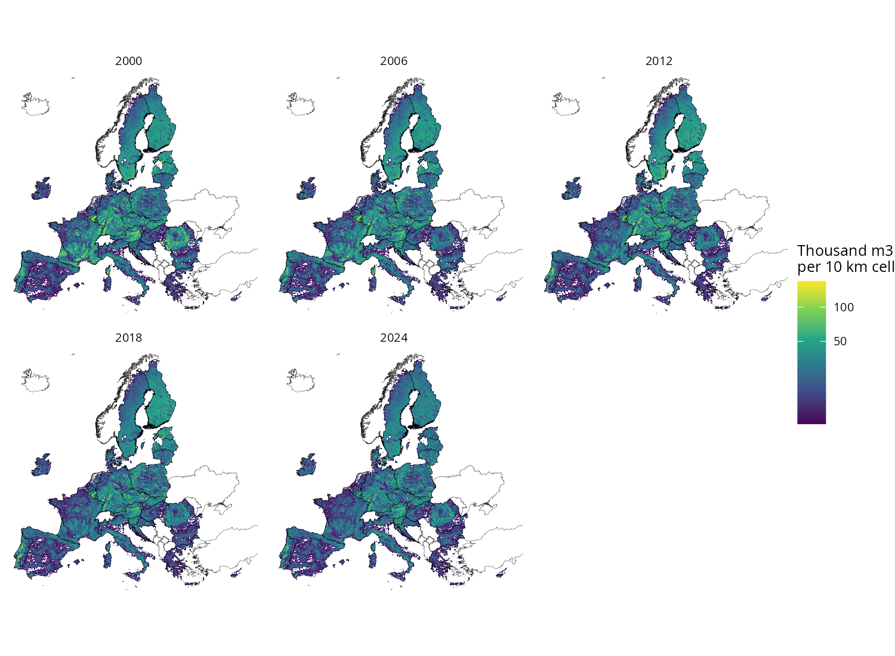
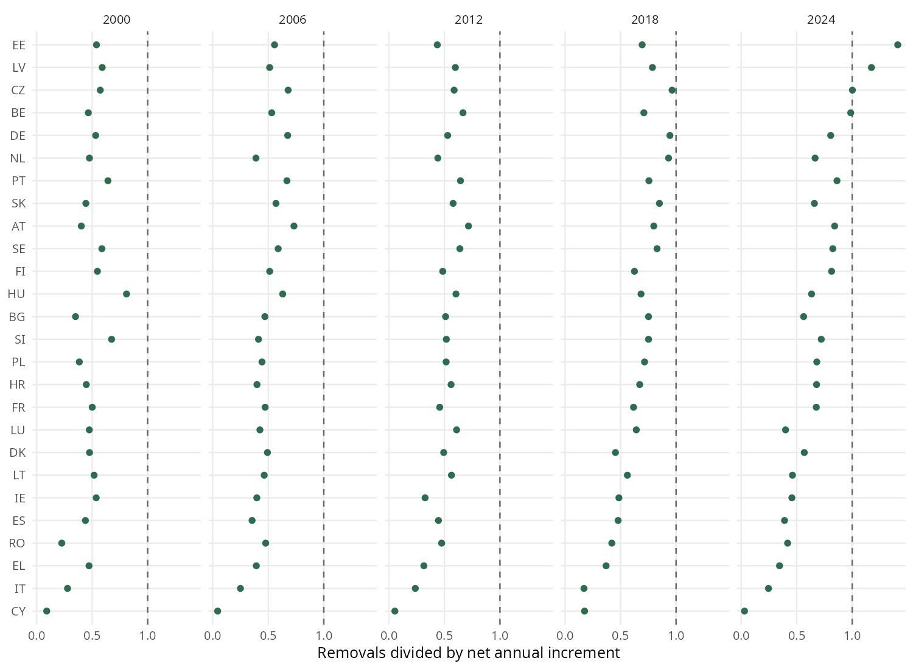
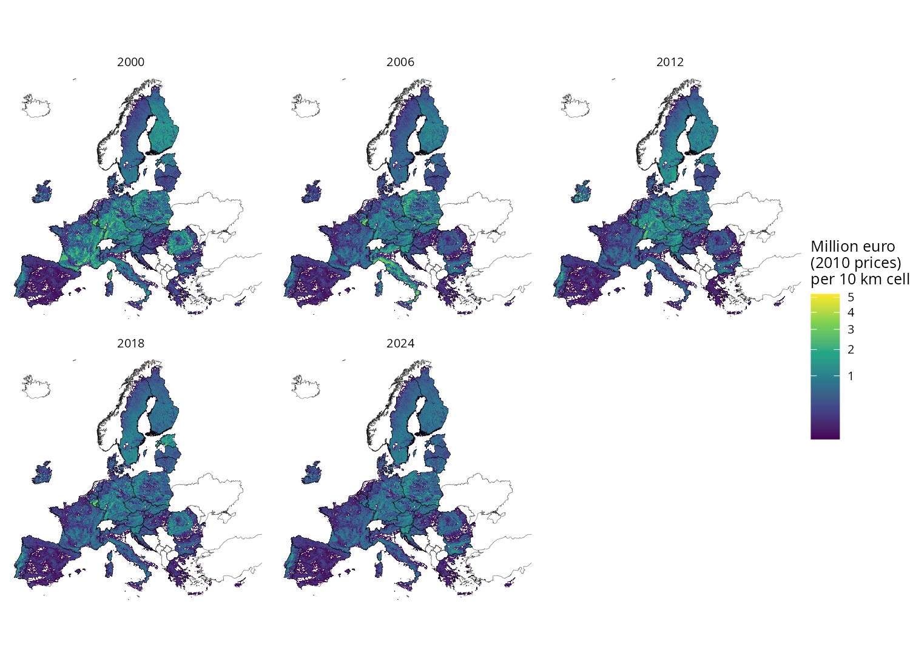
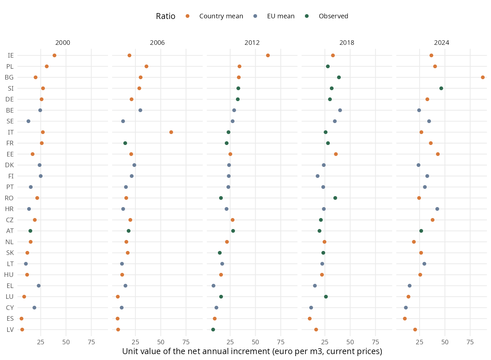

```{r}
#| label: setup
#| include: false

source("scripts/helpers_report.R", encoding = "UTF-8")

eu <- read_report("eu_series")
value_eu <- read_report("value_eu_series")
coverage <- read_report("reporting_coverage")
sources <- read_report("nai_sources")
removal_sources <- read_report("removals_sources")
rules <- read_report("gap_rule_comparison")
aggregates <- read_report("nai_against_aggregates")
breaks <- read_report("source_breaks")
latest <- read_report("nai_latest_year")
overuse_cases <- read_report("overuse_cases")
overuse_years <- read_report("overuse_all_years")
by_country <- read_report("physical_by_country")
value_country <- read_report("value_by_country")
monetary_coverage <- read_report("monetary_coverage")
screen <- read_report("ratio_screen")
ratio_summary <- read_report("ratio_summary")
ratio_sources <- read_report("ratio_sources")
export_points <- read_report("export_points_removed")
deflators <- read_report("deflators")
uv_range <- read_report("unit_value_range")
against <- read_report("value_against_published")
against_eu <- read_report("value_against_published_eu")
forest_mask <- read_report("forest_mask")
totals_1km <- read_report("maps_1km_totals")
checks <- bind_rows(read_report("checks_physical"), read_report("checks_monetary"),
                    read_report("checks_maps_1km"), read_report("checks_maps_100m"))
regions <- read_report("region_counts")
published_fr <- read_report("published_france")
dmp_check <- read_report("dmp_gdmp_check")

# Lookups for the numbers quoted in the text.
in_year <- function(table, y) table[table$year == y, ]
rule <- function(name, y) rules[rules$rule == name & rules$year == y, ]
rule_error <- function(name) paste(num(rules$absolute_differences[rules$rule == name]), collapse = ", ")
total_forest <- "Total forest reported to Eurostat"
cbm_total <- "Carbon budget model, total forest"
cbm_scaled <- "Carbon budget model, scaled to available forest"
break_of <- function(g) breaks[breaks$geo == g, ]
published_value <- function(g, y) against[against$geo == g & against$year == y, ]
carried_2024 <- sum(in_year(sources, 2024)$carried)
```

# Summary {.unnumbered}

We provide estimates of the wood provision ecosystem service for the 27 Member States of the European Union in 2000, 2006,
2012, 2018 and 2024, following the accounting method of INCA Part III [@lanotte2021], which updates INCA Part II
[@vallecillo2019]. The actual flow is the net annual increment of the forest available for wood supply, which falls from
`r num(in_year(eu, 2000)$nai)` million cubic metres in 2000 to `r num(in_year(eu, 2024)$nai)` million cubic metres in 2024. Part
of that fall comes from a change of source within the series, as @sec-breaks shows. Removals stay below the increment in every
Member State in the reporting years up to 2018, so the sustainable flow equals the removals in those years. In 2024,
`r in_year(eu, 2024)$n_overuse` Member States show overuse, adding up to `r num(in_year(eu, 2024)$overuse, 1)` million cubic metres,
and those flags rest on values carried forward from earlier years. At constant 2010 prices, the actual flow is worth
`r num(in_year(value_eu, 2000)$flow_constant / 1000, 1)` billion euro in 2000 and `r num(in_year(value_eu, 2024)$flow_constant / 1000, 1)`
billion euro in 2024, and the overuse of 2024 is worth `r num(in_year(value_eu, 2024)$overuse_constant)` million euro. All quantities are
reported by NUTS0, NUTS2 and NUTS3 region and mapped at 100 m.

# Introduction

Wood provision is the ecological contribution to the production of timber that can be harvested and used as a raw material. Its
underlying process is the natural growth of a biotic resource, so the accounts measure it through the net annual increment
(NAI) of standing timber in the forest available for wood supply [@lanotte2021]. NAI is the average annual growth in volume of
living trees less the average annual losses from natural mortality, measured here in cubic metres over bark
[@eurostat2026handbook]. Forest available for wood supply is forest without environmental, social or economic restrictions with a
significant impact on the supply of wood.

Services with a regeneration rate can be used faster than they renew, so the accounts also compare use with regeneration. Overuse
is the part of the use that exceeds regeneration, and the sustainable flow is the part that stays within it.

This report describes how we estimated those quantities and valued them, why we took each decision along the way and what the
estimates show. The calculations are carried out by a series of scripts in the folder
<https://github.com/renatovargas/jrc-wood-provision/tree/main/scripts>, listed in @tbl-scripts in the order in which they run. Each step of
the Methods section points to the entry of its script in Annex I, which explains what the script does and links to its code. The file
[run_all.R](#script-run-all) runs the whole series or any of its stages, and any single script can run again when only one input changes. The
tables and the 100 m maps can be retrieved from the Downloads page of this site.

| Script | Purpose |
|:-------|:--------|
| [00_prepare_gdmp_annual.R](#script-00) | Annual productivity from the ten-day files, run by hand |
| [01_prepare_nuts.R](#script-01) | Country boundaries |
| [02_download_eurostat.R](#script-02) | Forest volumes, value of forest trees, roundwood exports and prices |
| [03_prepare_carbon_budget.R](#script-03) | Increment estimated by the carbon budget model |
| [04_extract_manual_annex.R](#script-04) | Published tables by Member State, for comparison |
| [05_prepare_weights.R](#script-05) | Forest times productivity, at 100 m and 1 km |
| [06_prepare_nuts_weights.R](#script-06) | Share of each region in the weight of its country |
| [07_build_physical_accounts.R](#script-07) | Actual flow, sustainable flow and overuse by country |
| [08_build_monetary_accounts.R](#script-08) | Unit values, value by country and the results workbook |
| [09_write_maps_1km.R](#script-09) | Maps at 1 km, their checks and the map figures |
| [10_write_maps_100m.R](#script-10) | Maps at 100 m |
| [11_check_maps_100m.R](#script-11) | Comparison of the 100 m maps with the tables |
| [12_compare_dmp_gdmp.R](#script-12) | Test of Dry Matter Productivity against Gross Dry Matter Productivity, run by hand |

: Scripts of the pipeline, in the order in which they run. Each name links to its entry in Annex I. {#tbl-scripts}

## Sources of orientation

The method comes from Chapter 4 of INCA Part II and Section 6.2 of INCA Part III, and these reports settle any question they
address. Section 6.2 of Part III replaces two steps of Part II. It reports the whole NAI as the flow, because the forest asset
accounts already record natural growth as an addition to the stock, and because forest management does not change stand volume
growth much within a range of thinning grades [@lanotte2021]. The ecosystem contribution coefficient of Part II is therefore
dropped. It also replaces the valuation through the output of forestry with a valuation through export prices.

The INCA tool applies the same method and adds details that the reports do not state, such as the list of outliers described in
@sec-screen [@incatool]. We took those details from it. The reports give no method for overuse of wood or for the sustainable
flow, so those steps are decisions of this work, explained below.

# Methods

## Territory and reporting regions

The accounts cover the EU27 with the NUTS 2024 boundaries, at the country level (`r regions$NUTS0` regions), NUTS2 (`r regions$NUTS2`
regions) and NUTS3 (`r regions$NUTS3` regions) [@gisco2024nuts] (see [01_prepare_nuts.R in Annex I](#script-01)). The boundaries carry the notice © EuroGeographics for the administrative boundaries. Malta has no forest available
for wood supply and no forestry activity [@vallecillo2019], so its values are zero throughout.

## Actual flow

The source of the actual flow is the table `for_vol_efa` of Eurostat, which collects the European Forest Accounts in thousand cubic
metres over bark [@eurostat2026forvolefa] (see [02_download_eurostat.R in Annex I](#script-02)). @tbl-coverage shows why it needs completing, since
the NAI of forest available for wood supply is reported by few Member States before 2018.

```{r}
#| label: tbl-coverage
#| tbl-cap: "Member States out of 27 that report each series in `for_vol_efa`. FAWS is forest available for wood supply and FOR is total forest."

coverage |>
  mutate(flow = recode(flow, NAI = "Net annual increment", RMOV = "Removals")) |>
  rename(Series = flow, Forest = forest_class) |>
  show_table(digits = 0)
```

### Filling the gaps

INCA Part III fills the gaps with the estimates of the carbon budget model [@lanotte2021; @pilli2021]. These estimates are published
in a workbook that combines the model with the forest accounts and gives the total NAI of each country from 2000 to 2019, with the
values after 2016 held at their level of 2015 (see [03_prepare_carbon_budget.R in Annex I](#script-03)). The series refers to total forest, and
the workbook also gives the share of available forest in the growing stock, so two versions of the fill are possible. The INCA tool
uses a third, the NAI of total forest reported to Eurostat. @tbl-rules compares all three with the values by Member State printed
in the annexes of Part III, which are the published reference for the method (see [04_extract_manual_annex.R in Annex I](#script-04) for
the annexes and [07_build_physical_accounts.R in Annex I](#script-07) for the comparison).

```{r}
#| label: tbl-rules
#| tbl-cap: "Rules to fill the gaps in the NAI of available forest, against the values of Annexes AA37, AA41 and AA45 of INCA Part III. The differences add up the absolute gap of each Member State, without the United Kingdom."

rules |>
  transmute(Rule = rule, Year = as.integer(year), `EU27 (million m3)` = eu_total, `Published (million m3)` = published_total,
            `Sum of differences (million m3)` = absolute_differences, `Median difference (%)` = median_difference_pct) |>
  show_table(digits = 0) |>
  colformat_double(j = "Median difference (%)", digits = 1)
```

The total forest fallback has the closest EU totals, but only because errors offset, as its country differences are the largest,
at `r rule_error(total_forest)` million cubic metres in the three years. The total forest estimate of the carbon budget model gives
`r rule_error(cbm_total)` million cubic metres. It follows the method that Part III states and reproduces its member state values
best, so a decision was made to use it. The NAI is therefore taken in this order. A value reported for available forest comes first.
The carbon budget estimate comes next. Any remaining gap takes the mean of the nearest earlier and later values of the same country,
and gaps at the end of the series repeat the last value. @tbl-sources shows what each reporting year rests on.

```{r}
#| label: tbl-sources
#| tbl-cap: "Origin of the NAI of the 27 Member States in the reporting years. Malta is the entry with no supply."

sources |>
  transmute(Year = as.integer(year), Reported = reported, `Carbon budget model` = carbon_budget, Carried = carried,
            `No supply` = no_supply) |>
  show_table(digits = 0)
```

The carbon budget estimate covers total forest and fills a statistic of available forest, so it probably overstates the flow in the
countries that take it. @tbl-aggregates shows the size of this effect against the EU27 aggregates that Eurostat publishes, which it
estimates itself. The accounts sit above the aggregate for available forest by
`r num(100 * (in_year(aggregates, 2012)$accounts / in_year(aggregates, 2012)$eurostat_FAWS - 1))` percent in 2012.

```{r}
#| label: tbl-aggregates
#| tbl-cap: "EU27 NAI in the accounts, the Eurostat aggregates and the sum of the published Member State values without the United Kingdom, in million cubic metres."

aggregates |>
  transmute(Year = as.integer(year), Accounts = accounts, `Eurostat, available forest` = eurostat_FAWS,
            `Eurostat, total forest` = eurostat_FOR, `INCA Part III` = published) |>
  show_table(digits = 0)
```

Eurostat holds very few values for 2024. @tbl-latest gives the last year with an original value for each Member State, so the column
of 2024 mostly repeats earlier years, and the method says nothing about how far a value may be carried. A decision was made to carry
the last value, since the increment changes slowly and any trend applied to it would add an assumption that the data cannot support.

```{r}
#| label: tbl-latest
#| tbl-cap: "Last year with a value reported or estimated for the NAI, as a count of Member States."

latest |>
  transmute(`Last year` = as.integer(last_year), `Member States` = n) |>
  show_table(digits = 0)
```

### Changes of source within the series {#sec-breaks}

A Member State that starts reporting available forest moves from the estimate of the model to its own figure, and the two can differ
widely. @tbl-breaks lists the Member States where this happens between two reporting years. France falls by
`r num(-break_of("FR")$change_pct)` percent between 2006 and 2012 and Sweden by `r num(-break_of("SE")$change_pct)` percent between
2012 and 2018, and in both cases the model estimate of the later year is far from the reported figure. Part III has the same feature,
since its value for France goes from `r num(published_fr$published[published_fr$year == 2000] / 1000)` million cubic metres in 2000 to `r num(published_fr$published[published_fr$year == 2012] / 1000)` million in 2012. We kept the series as the method builds
it and did not adjust the model estimates to the reported levels, so changes over time within these countries should be read
together with this table.

```{r}
#| label: tbl-breaks
#| tbl-cap: "Member States whose NAI changes from the model estimate to a reported value between two reporting years, in thousand cubic metres."

breaks |>
  transmute(Country = geo, From = as.integer(previous_year), To = as.integer(year), `NAI, from` = previous_value, `NAI, to` = value,
            `Model, to` = cbm_same_year, `Change (%)` = change_pct) |>
  show_table(digits = 0)
```

## Sustainable flow and overuse

The accounting reports class wood among the services with a regeneration rate that use can exceed [@lanotte2021], and the handbook of
ecosystem accounts describes overharvesting as removals above the NAI [@eurostat2026handbook]. Neither gives a formula for wood, so we
adapted the one of Part III for water purification, in which overuse is the difference between the actual and the sustainable flow
and the threshold defines the sustainable flow. Regeneration is the threshold for wood, which gives these two equations for each
country and year.

$$
\text{Overuse} = \max(\text{Removals} - \text{NAI},\ 0)
$$ {#eq-overuse}

$$
\text{Sustainable flow} = \min(\text{Removals},\ \text{NAI})
$$ {#eq-sustainable}

Removals are the removals of available forest in `for_vol_efa`, which Member States report more widely than the NAI, as
@tbl-coverage shows. They take the same rule for gaps, with reported removals of total forest in place of the model estimate. The two
quantities add up to the removals in every country and year (see [07_build_physical_accounts.R in Annex I](#script-07)). A single year above the
threshold can be a temporary peak, for example after a storm, so the table of results also gives the ratio of removals to NAI, and the
handbook treats overharvesting as a matter of an extended period.

## Monetary valuation

The value is the physical quantity times a unit value in euro per cubic metre. INCA Part III derives the unit value in three steps
[@lanotte2021]. The output of forest trees in `for_sup_cp` [@eurostat2026forsupcp] divided by the NAI gives the unit value of the NAI,
which few Member States report in the early years, as @tbl-monetary-coverage shows. The roundwood exports of `for_basic`
[@eurostat2026forbasic], in value and in volume, give a unit value for most countries and years, but this price includes the
harvesting and transport added on the way to the market. The ratio between the two then carries the export price back to the standing
tree.

$$
\text{Ratio}_{c,t} = \frac{\text{Unit value of exports}_{c,t}}{\text{Unit value of NAI}_{c,t}}
$$ {#eq-ratio}

$$
\text{Completed unit value}_{c,t} = \frac{\text{Unit value of exports}_{c,t}}{\widehat{\text{Ratio}}_{c,t}}
$$ {#eq-unit-value}

Where the ratio is missing, $\widehat{\text{Ratio}}$ takes the mean ratio of the country, or the EU mean if the country has no ratio at
all (see [08_build_monetary_accounts.R in Annex I](#script-08)). Gaps in the export price take the same means. Means run over 2000 to 2023 for a country.
The EU mean takes the mean of the countries in each year and then the mean of those years from 2012 to 2023, where coverage is better,
as in the INCA tool.

```{r}
#| label: tbl-monetary-coverage
#| tbl-cap: "Member States out of 27 with a reported timber value and an export unit value."

monetary_coverage |>
  mutate(Year = as.integer(Year)) |>
  show_table(digits = 0)
```

### Screening the ratio {#sec-screen}

The ratio is very sensitive to small denominators. Eurostat records the output of forest trees in Croatia as
0.00 or 0.01 million euro, which yields a ratio near `r num(ratio_summary$uncleaned_hr_ratio)`. With no screening, the EU mean of the
ratio is `r num(ratio_summary$eu_ratio_uncleaned)`, against a median of `r num(ratio_summary$median_screened, 1)` among the ratios kept after screening, so every Member State that takes the EU
mean ends up with a unit value close to zero.

The INCA tool removes all the timber values of Croatia, Finland, Greece, Portugal and Sweden and the export points of Denmark in 2014 and
Greece in 2006 [@incatool], and we did the same. The data used here are more recent than that list, so it does not catch everything. Lithuania
now has a median ratio of `r num(ratio_summary$uncleaned_lt_ratio)`. Belgium has a median of `r num(ratio_summary$uncleaned_be_ratio, 2)`, which
would make the standing tree worth more than the harvested roundwood, and Part III reports Belgium at a far lower value. A decision was
made to extend the rule in a way that the data support. A Member State whose median ratio falls below 1 or above 100 loses all its timber
values, and any single observation outside that range is dropped. The lower bound follows from the meaning of the ratio. Among the Member States left after the list of the INCA tool, no ratio lies between 13
and 1,000, so any upper bound in that range gives the same result. @tbl-screen shows the outcome. After screening,
the EU mean of the ratio is `r num(ratio_summary$eu_ratio, 2)`.

```{r}
#| label: tbl-screen
#| tbl-cap: "Ratio of export to timber unit values by Member State, after the removal of export errors and before the screening of the ratio."

screen |>
  transmute(Country = geo, Observations = n_observed, Median = median_ratio, Minimum = min_ratio, Maximum = max_ratio, Treatment = treatment) |>
  show_table(digits = 1) |>
  fontsize(size = 8, part = "all")
```

Export prices have their own errors. A decision was made to drop a point that lies more than three times above or below the median of its
country, a rule that also catches the Greek point of the INCA tool, while the Danish point has no data in this release. It removes
`r nrow(export_points)` points, listed in @tbl-export-points, and `r sum(export_points$year %in% c(2000, 2006, 2012, 2018, 2024))` of them fall in reporting years. Among those, Croatia in 2012 stands at
`r num(export_points$unit_value[export_points$geo == "HR" & export_points$year == 2012], 1)` euro per cubic metre against a median of
`r num(export_points$country_median[export_points$geo == "HR" & export_points$year == 2012], 1)`, and Romania in 2024 at
`r num(export_points$unit_value[export_points$geo == "RO" & export_points$year == 2024], 1)` euro against a median of
`r num(export_points$country_median[export_points$geo == "RO" & export_points$year == 2024], 1)`. @tbl-ratio-sources shows how much of the
result rests on each kind of ratio after these steps.

```{r}
#| label: tbl-export-points
#| tbl-cap: "Export unit values removed, in euro per cubic metre."

export_points |>
  transmute(Country = geo, Year = as.integer(year), `Unit value` = unit_value, `Median of the country` = country_median) |>
  show_table(digits = 1)
```

```{r}
#| label: tbl-ratio-sources
#| tbl-cap: "Origin of the ratio of the 27 Member States in the reporting years."

ratio_sources |>
  transmute(Year = as.integer(year), Observed = observed, `Country mean` = country_mean, `EU mean` = eu_mean) |>
  show_table(digits = 0)
```

### Constant prices

Part III moves its other accounts to constant prices, so that the accounts follow changes in the service and leave aside changes in the
market [@lanotte2021]. It does not state a deflator or a price basis for wood. The accounts therefore report both current and constant prices. Constant prices multiply the value of each year by the deflator of @tbl-deflators, which is the HICP of
the EU27 [@eurostat2026hicp] rebased to 2010. A single EU27 index and the base year 2010 are a method choice that keeps all the accounts
of this series on one price basis, and the INCA tool uses national indices with base year 2000 instead.

```{r}
#| label: tbl-deflators
#| tbl-cap: "Deflator applied to current prices, with 2010 equal to 1."

deflators |>
  transmute(Year = as.integer(year), Deflator = deflator) |>
  show_table(digits = 3)
```

Overuse and the sustainable flow take the same unit value as the NAI of their country and year, since the method has no separate price
for them.

## The spatial key

Part II spreads national flows over the forest of Corine Land Cover in proportion to Dry Matter Productivity [@vallecillo2019], and the
Earth observation roadmap of the INCA project keeps a forest mask and that proxy [@zurbaran2025]. The weight of a 100 m cell in year $t$ is
therefore

$$
w_{i,t} = F_{i,t} \cdot P_{i,t}
$$ {#eq-weight}

where $F_{i,t}$ is 1 for forest in the Corine accounting layer of the year [@eea2026clcacc] and 0 elsewhere, and $P_{i,t}$ is the annual
productivity resampled to 100 m with bilinear interpolation (see [05_prepare_weights.R in Annex I](#script-05)). A cell then receives

$$
\text{Value}_{i,t} = \text{Value}_{c,t} \cdot \frac{w_{i,t}}{\sum_{j \in c} w_{j,t}}
$$ {#eq-spread}

so the cells of a country add up to its national value (see [10_write_maps_100m.R in Annex I](#script-10)).

**Forest mask.** Part II limits the mask to the broad-leaved, coniferous and mixed forest classes (311, 312 and 313) and leaves out
transitional woodland and shrub (324) [@vallecillo2019]. The INCA tool includes that class, so the two differ, and a decision was made to
follow the report. @tbl-forest-mask shows that the excluded class equals `r num(100 * forest_mask$transitional_ha[forest_mask$year == 2018] / forest_mask$forest_ha[forest_mask$year == 2018])` percent of the mask in 2018.

```{r}
#| label: tbl-forest-mask
#| tbl-cap: "Area of the forest mask and of the excluded class in the EU27, in million hectares."

forest_mask |>
  transmute(Year = as.integer(year), `Forest mask (311, 312, 313)` = forest_ha / 1e6, `Transitional woodland and shrub (324)` = transitional_ha / 1e6) |>
  show_table(digits = 1)
```

**Availability.** The mask holds all forest, available or not. Part II tried to delineate available forest through slope and protected
areas and rejected this, because thresholds differ across countries and the result can mislead [@vallecillo2019]. A map of available forest
now exists for 2020 [@jrc2026faws], and a decision was made to leave it out. It covers one year in a series of five, the reports do not
call for it, and the statistic that is spread already refers to available forest.

**Productivity.** Part II and the roadmap name Dry Matter Productivity. This work uses Gross Dry Matter Productivity, a separate Copernicus
product that also counts the autotrophic respiration of the plants, because it was the product at hand and the other needs a further bulk
download.^[The annual layers are the sum of the 36 ten-day values of each year, each multiplied by its number of days (see [00_prepare_gdmp_annual.R in Annex I](#script-00)).] The proxy only shares
a national value among the cells of a country, so what matters is the relative pattern within a country and national totals do not depend on
it. The 1 km product, version 2, serves 2000, 2006 and 2012 [@copernicus2020gdmp1km], and the 300 m product, version 2, serves 2018 and 2024
[@copernicus2020gdmp300].

A test then measured what this choice costs (see [12_compare_dmp_gdmp.R in Annex I](#script-12)). It compared the Dry Matter Productivity products
[@copernicus2020dmp1km; @copernicus2020dmp300] with half of the gross products, since the quality page of the 1 km product describes a constant fraction of 0.5. It covers
`r nrow(dmp_check)` of the 180 pairs of files behind the key, namely the files ending on 10 January and 10 July of each reporting year, over the whole of Europe. The tolerance
was set before the comparison. In every pair, the absolute difference could reach `r num(100 * dmp_check$tolerance_difference[1])` percent of the productivity total, and the cells with
data in only one product could reach `r num(100 * dmp_check$tolerance_unmatched[1], 1)` percent of the cells. @tbl-dmp shows the outcome, which is that Dry Matter Productivity equals exactly half
of the gross value in every cell, with data in the same cells. A constant ratio leaves the share of every cell unchanged, so on this evidence the two products give the same key, and the key stays on
Gross Dry Matter Productivity. The other `r 180 - nrow(dmp_check)` pairs were not compared, so the finding rests on this sample.

```{r}
#| label: tbl-dmp
#| tbl-cap: "Dry Matter Productivity against half of Gross Dry Matter Productivity, by pair of files over Europe. Cells are in millions, and the two gaps are percentages."

dmp_check |>
  transmute(`File date` = date, Product = product, `Cells with data` = cells_with_data / 1e6,
            `Data in one product only (%)` = 100 * unmatched_share, `Absolute difference (%)` = 100 * difference_share,
            `Within tolerance` = if_else(within_tolerance, "Yes", "No")) |>
  show_table(digits = 1)
```

## Regional tables

The value of a region is the national value times the share of the region in the weight of its country in that year, so the regions add up to
the country and follow the same key as the maps (see [06_prepare_nuts_weights.R in Annex I](#script-06) for the shares and
[helpers_results.R in Annex I](#script-helpers) for the regional values). Shares are
computed on the 1 km weights, which keeps the step in the repository. All regions of a country therefore share one unit value, and the overuse
of a country reaches all its regions in proportion to their weight, since the data do not show where removals take place inside a country.

## Maps

The maps use the projection EPSG:3035 on a 100 m grid aligned with the Corine grid. There are six per year, for the actual flow, the sustainable
flow and the overuse, in physical terms and in constant prices, which gives 30 maps. They hold whole numbers per cell, in cubic decimetres
and in euro cents, which makes the files several times smaller than decimals with no loss that matters at this resolution. Because they are too large for
the repository, they are kept in an external folder with a README file. The 1 km maps of the flow and its value are kept outside the repository
as well, and they give the figures of this report (see [09_write_maps_1km.R in Annex I](#script-09)).

## Checks

Each script stops when a check fails and records the result. @tbl-checks lists them with the largest relative gap found. The 100 m maps are read
back from disk and compared with the national values country by country (see [11_check_maps_100m.R in Annex I](#script-11)). Script 08 also stops if the NUTS2 and NUTS3
totals differ from the NUTS0 totals in any table, metric or year.

```{r}
#| label: tbl-checks
#| tbl-cap: "Checks in the scripts. A script stops if a gap exceeds its tolerance."

checks |>
  transmute(Check = check, `Largest gap` = formatC(largest_gap, format = "e", digits = 1),
            Tolerance = formatC(tolerance, format = "e", digits = 0)) |>
  show_table()
```

# Results

## Actual flow

@tbl-eu shows the accounts for the EU27. The NAI falls by `r num(100 * (1 - in_year(eu, 2024)$nai / in_year(eu, 2000)$nai))` percent between
2000 and 2024. Eurostat's own aggregate for available forest falls too, from `r num(in_year(aggregates, 2000)$eurostat_FAWS)` million cubic metres
in 2000 to `r num(in_year(aggregates, 2018)$eurostat_FAWS)` million in 2018, by
`r num(100 * (1 - in_year(aggregates, 2018)$eurostat_FAWS / in_year(aggregates, 2000)$eurostat_FAWS))` percent, so part of the fall is present in the
statistics themselves, and the changes of source described in @sec-breaks add to it.

```{r}
#| label: tbl-eu
#| tbl-cap: "Physical accounts of the EU27, in million cubic metres. The last column counts Member States with overuse."

eu |>
  transmute(Year = as.integer(year), `Actual flow (NAI)` = nai, Removals = removals, `Sustainable flow` = sustainable, Overuse = overuse,
            `Countries with overuse` = as.integer(n_overuse)) |>
  show_table(digits = 1)
```

@fig-map-nai shows where the flow is placed. Borders between countries can appear on the map, because each country spreads its own national total.

{#fig-map-nai}

## Sustainable flow and overuse

Removals grow from `r num(in_year(eu, 2000)$removals)` million cubic metres in 2000 to `r num(in_year(eu, 2018)$removals)` million in 2018, and they
take `r num(100 * in_year(eu, 2018)$removals / in_year(eu, 2018)$nai)` percent of the NAI in that year against
`r num(100 * in_year(eu, 2000)$removals / in_year(eu, 2000)$nai)` percent in 2000. @fig-ratio shows the ratio by Member State. @tbl-overuse lists
the cases of overuse in the reporting years. All of them fall in 2024, and both sides of each comparison repeat earlier years, so they
describe the last reports of those Member States and may not describe 2024 itself. Czechia sits almost exactly on the threshold, with a ratio of
`r num(overuse_cases$removals_to_nai[overuse_cases$geo == "CZ"], 3)`. Looking at every year of the series, overuse appears in
`r sum(overuse_years$n[overuse_years$year >= 2019 & overuse_years$year <= 2023])` country-years between 2019 and 2023, so the reporting years
understate how often the threshold has been crossed recently.

```{r}
#| label: tbl-overuse
#| tbl-cap: "Member States with overuse in the reporting years, in thousand cubic metres."

overuse_cases |>
  transmute(Year = as.integer(year), Country = geo, NAI = nai, Removals = removals, Overuse = overuse_volume, `Removals / NAI` = removals_to_nai,
            `NAI origin` = nai_source, `Removals origin` = removals_source) |>
  show_table(digits = 1) |>
  colformat_double(j = "Removals / NAI", digits = 3)
```

{#fig-ratio}

## Value

@tbl-value gives the value of each quantity. In current prices the flow rises by
`r num(100 * (in_year(value_eu, 2024)$flow_current / in_year(value_eu, 2000)$flow_current - 1))` percent over the period, and in constant prices it falls by
`r num(100 * (1 - in_year(value_eu, 2024)$flow_constant / in_year(value_eu, 2000)$flow_constant))` percent, since the deflator removes the general rise in prices and the NAI itself falls. @fig-map-value maps the flow in constant prices. Each cell of a country has the same unit value,
so within a country this map has the pattern of the physical map. @fig-unit-value shows the unit values, whose median in 2018 is
`r num(in_year(uv_range, 2018)$median, 1)` euro per cubic metre.

```{r}
#| label: tbl-value
#| tbl-cap: "Monetary accounts of the EU27, in million euro."

value_eu |>
  transmute(Year = as.integer(year), `Actual flow, current prices` = flow_current, `Actual flow, 2010 prices` = flow_constant,
            `Sustainable flow, 2010 prices` = sustainable_constant, `Overuse, 2010 prices` = overuse_constant) |>
  show_table(digits = 0)
```

{#fig-map-value}

{#fig-unit-value}

## Comparison with the published accounts {#sec-published}

@tbl-published compares the value in current prices with the annexes of INCA Part III, for the same 27 Member States. The annexes do not state their price basis. Their values for 2012 match our current prices closely, which would also fit a constant series based on 2012, so the comparison of earlier years is the less certain one. The year 2012 lies within
`r num(abs(100 * (in_year(against_eu, 2012)$accounts / in_year(against_eu, 2012)$published - 1)), 1)` percent of the published total, and 2000 and 2006 each lie about
`r num(100 * (1 - in_year(against_eu, 2000)$accounts / in_year(against_eu, 2000)$published))` percent below it. Several large countries agree closely in 2012, as Germany at `r num(published_value("DE", 2012)$flow_current)` million euro against
`r num(published_value("DE", 2012)$published)` million and Sweden at `r num(published_value("SE", 2012)$flow_current)` million against
`r num(published_value("SE", 2012)$published)` million. The largest relative gap in that year is Croatia, at `r num(published_value("HR", 2012)$flow_current)` million euro
against `r num(published_value("HR", 2012)$published)` million, which comes from the export point of 2012 removed above. Part III holds an earlier release of the same statistics,
so an exact match is neither possible nor expected.

```{r}
#| label: tbl-published
#| tbl-cap: "Value of the actual flow in current prices against INCA Part III, EU27, in million euro."

against_eu |>
  transmute(Year = as.integer(year), Accounts = accounts, `INCA Part III` = as.numeric(published), `Median difference by country (%)` = median_difference_pct) |>
  show_table(digits = 0)
```

# Limitations

**Statistics.** Values reported for available forest cover few countries before 2018, and most values before then are model estimates of total forest, so
they probably overstate the flow. Changes of source move the series for reasons that have nothing to do with forests, as @tbl-breaks shows, so comparisons
over time within those countries need care. The carbon budget series ends in 2019 and is flat from 2016, and the values of 2024 mostly repeat earlier years. They should
be refreshed when Eurostat holds more of that year.

**Overuse.** The removals of available forest are compared with a NAI that in some countries refers to total forest, which understates overuse in those countries.
The ratio could cross the threshold in more countries if the model estimates were scaled to available forest. Regional overuse is the national
overuse shared by the key, so it does not show where overharvesting occurs inside a country. A map of overuse has the same limit.

**Value.** Few countries report the timber value before 2012, so most early values come from an export price divided by a mean ratio, and the monetary series is better
read as an estimate than as a measurement. `r in_year(ratio_sources, 2012)$eu_mean` Member States take the EU mean, of which `r sum(screen$treatment != "Kept")` lost their timber values in the screening, so they
all share one ratio. A country with low export volumes can have an unrepresentative export price. Every cell and region of a country has one unit value, so the
maps do not show price differences within a country.

**Space.** The key combines forest with the productivity of the vegetation, and productivity measures growth of vegetation in general, so some flow is placed on forest
that is not harvested. Productivity comes from a 1 km product in 2000, 2006 and 2012 and from a 300 m product in 2018 and 2024, so spatial detail differs between the two groups and
changes in the pattern between them partly reflect the change of product. The equivalence of the gross and net products rests on a sample of `r nrow(dmp_check)` of the 180 pairs of files, as the Methods section explains. The Corine accounting layers have a minimum mapping unit of 25 hectares.
Regional shares use weights at 1 km, whose cells on borders are assigned by their centre, so they can differ slightly from a sum of the 100 m maps.

# Appendix: accounts by Member State {.unnumbered}

```{r}
#| label: tbl-appendix
#| tbl-cap: "Actual flow and its value by Member State in 2000, 2012 and 2024. NAI is in thousand cubic metres and value in million euro at 2010 prices."

by_country |>
  filter(year %in% c(2000, 2012, 2024)) |>
  left_join(value_country, by = c("geo", "year")) |>
  select(geo, year, nai, flow_constant) |>
  pivot_wider(names_from = year, values_from = c(nai, flow_constant), names_glue = "{.value} {year}") |>
  rename(Country = geo) |>
  rename_with(\(x) sub("nai", "NAI", sub("flow_constant", "Value", x))) |>
  show_table(digits = 0) |>
  fontsize(size = 8, part = "all")
```

# References {.unnumbered}

::: {#refs}
:::



# Annex I. Scripts of the pipeline {.unnumbered}

This annex describes each script in the order in which it runs. The link under each name opens its code on GitHub, and the paragraph explains
what the script takes in, what it does and what it saves for the steps that follow. Script 00 builds the annual productivity layers and runs only by hand. Scripts 01 to 06 prepare the inputs. Scripts 01 and 06 run from the repository alone, script 02 needs internet
access, and scripts 03 to 05 need source files that are kept outside the repository. Scripts 07 to 09 run from the repository alone. Scripts 10 and
11 write and check the 100 m maps, and they need large files kept outside the repository again. Script 12 is a test that runs by hand, and the report reads the small table it saved.

## 00_prepare_gdmp_annual.R {#script-00 .unnumbered .unlisted}

[View on GitHub](https://github.com/renatovargas/jrc-wood-provision/blob/main/scripts/00_prepare_gdmp_annual.R)

This script builds the annual productivity layers from the ten-day files of Gross Dry Matter Productivity, using the 1 km product for 2000, 2006 and 2012
[@copernicus2020gdmp1km] and the 300 m product for 2018 and 2024 [@copernicus2020gdmp300]. It reads the part of each file that covers Europe from the Copernicus Data Space
Ecosystem, multiplies the daily rate by the days that the file covers, counts missing cells as zero and adds up the 36 files of the year. It saves one file per year,
`gdmp_<product>_<year>_4326.tif`, outside the repository for script 05. The pipeline does not run this script every time, because it needs Copernicus access keys, reads 180 files over the
network for hours and uses many gigabytes of temporary disk space, while its five results take about 1 GB and rarely need replacing. Its line is therefore commented out in
[run_all.R](#script-run-all), and it skips any layer that already exists.

## 01_prepare_nuts.R {#script-01 .unnumbered .unlisted}

[View on GitHub](https://github.com/renatovargas/jrc-wood-provision/blob/main/scripts/01_prepare_nuts.R)

This script takes the NUTS 2024 boundaries of Eurostat at a scale of 1:1 million [@gisco2024nuts], in the copy distributed with the INCA plugin
[@incatool], and keeps only the level of countries. It marks the 27 Member States and stops if it does not find all of them. The result is a small
file, `NUTS_RG_01M_2024_3035_LEVL0.gpkg`, which the later scripts use to identify the countries and to draw the maps. The repository holds the source file with its
copyright notice.

## 02_download_eurostat.R {#script-02 .unnumbered .unlisted}

[View on GitHub](https://github.com/renatovargas/jrc-wood-provision/blob/main/scripts/02_download_eurostat.R)

This script downloads four tables through the Eurostat data service. From `for_vol_efa` [@eurostat2026forvolefa] it keeps the net annual increment
and the removals of every forest class, in thousand cubic metres. From `for_sup_cp` [@eurostat2026forsupcp] it keeps the output of forest trees, in
million euro. From `for_basic` [@eurostat2026forbasic] it keeps the exports of roundwood of all species, in value and in volume. The first three are
limited to 2000 to 2024. The fourth table is the annual price index of the EU27 for all items, with 2015 as its base [@eurostat2026hicp]. Each table
is saved as an rds file, namely `for_vol_efa_thsm3.rds` for the physical accounts and `for_sup_cp_p1tr.rds`, `for_basic_rw_exports.rds` and
`hicp_eu27.rds` for the monetary accounts. A new release of these tables changes the results, so this step runs only when an update is intended.

## 03_prepare_carbon_budget.R {#script-03 .unnumbered .unlisted}

[View on GitHub](https://github.com/renatovargas/jrc-wood-provision/blob/main/scripts/03_prepare_carbon_budget.R)

This script reads the workbook that combines the carbon budget model with the forest accounts [@pilli2021], which it downloads if the file is
missing. The workbook has one sheet per country and none for Malta. For each of the 26 other Member States and each year from 2000 to 2019, the script keeps the
total net annual increment and the share of available forest in the growing stock. It stops if a value is missing or if an increment is not positive.
The result is `cbm_nai.rds`, a small table that fills the gaps of the physical accounts in script 07.

## 04_extract_manual_annex.R {#script-04 .unnumbered .unlisted}

[View on GitHub](https://github.com/renatovargas/jrc-wood-provision/blob/main/scripts/04_extract_manual_annex.R)

This script reads the text of INCA Part III [@lanotte2021] and extracts the timber tables of Annexes AA37 to AA47, which give the supply by Member State in
2000, 2006 and 2012, in million cubic metres and in million euro. The annexes include the United Kingdom, so the script stops unless it finds 28 countries in each of the three
years. The result is `inca_part3_timber_annex.csv`, short enough to check by eye against the published annexes. Scripts 07 and 08 use it only for comparison, so
no result of the accounts depends on it.

## 05_prepare_weights.R {#script-05 .unnumbered .unlisted}

[View on GitHub](https://github.com/renatovargas/jrc-wood-provision/blob/main/scripts/05_prepare_weights.R)

This script builds the spatial key for each reporting year. It takes the Corine Land Cover accounting layer at 100 m [@eea2026clcacc] and the annual
Gross Dry Matter Productivity, from the 1 km product in 2000, 2006 and 2012 [@copernicus2020gdmp1km] and from the 300 m product in 2018 and 2024
[@copernicus2020gdmp300]. Script 00 builds these annual layers, and `manifest_heavy_inputs.csv` lists them with their sources. The script marks the forest classes 311, 312 and 313, resamples the productivity to the 100 m grid and multiplies the two, so cells outside forest or
outside the EU27 receive zero. The 100 m weights take about 2.4 GB for the five years, so they stay outside the repository for script 10. The script adds them up in cells of 1 km and saves each year as
`clc_gdmp_weight_1km_<year>.tif`, a file of about 11 MB that scripts 06 and 09 read. It also saves the hectares of forest and of the excluded class 324 as
`forest_mask.rds` for this report.

## 06_prepare_nuts_weights.R {#script-06 .unnumbered .unlisted}

[View on GitHub](https://github.com/renatovargas/jrc-wood-provision/blob/main/scripts/06_prepare_nuts_weights.R)

This script takes the boundaries of the countries, NUTS2 and NUTS3 regions of the EU27 [@gisco2024nuts], in the same copy as script 01, and the 1 km
weights of script 05. For each region and reporting year, it adds up the weight of the cells that fall inside the region and divides it by the total of
all regions of that level in the country. The result is `weight_by_nuts.rds`, which script 08 uses to share national values among the regions. The
number of regions at each level is saved as `region_counts.rds` for this report.

## 07_build_physical_accounts.R {#script-07 .unnumbered .unlisted}

[View on GitHub](https://github.com/renatovargas/jrc-wood-provision/blob/main/scripts/07_build_physical_accounts.R)

This script takes the forest volumes of script 02, the carbon budget estimates of script 03 and the published annexes of script 04. It builds the net annual
increment of each Member State and year from 2000 to 2024 from the value reported for available forest, then the carbon budget estimate, then the
mean of the nearest values of the country, and at the ends of the series the nearest value. Removals follow the same order, with reported removals
of total forest in place of the estimate. Malta takes zero. The script then compares removals with the increment to obtain the overuse and the
sustainable flow, and it stops if a value is missing or if the two quantities do not add up to the removals. It also tests the candidate rules for
the gaps against the annexes. It saves `wood_nai_faws_country_year.rds` and `wood_overuse_country_year.rds` for the later scripts, and it saves the small
tables of the physical results in `data/outputs/report/`, with the figure of the ratio of removals to increment.

## 08_build_monetary_accounts.R {#script-08 .unnumbered .unlisted}

[View on GitHub](https://github.com/renatovargas/jrc-wood-provision/blob/main/scripts/08_build_monetary_accounts.R)

This script takes the physical accounts of script 07, the output of forest trees, roundwood exports and price index of script 02, the regional shares of script 06
and the annexes of script 04. It computes the export price of each country and year and drops the points more than three times away from the median of the country. It
removes the outliers of the INCA tool [@incatool] and the countries and points whose ratio falls outside the range of @sec-screen, and it fills the gaps with country and
EU means. The export price divided by the ratio gives the unit value, and the unit value times the physical quantity gives the value, in current prices and in
constant 2010 prices. The script stops if a value is missing or if the deflator does not return to current prices. It saves
`wood_value_country_year.rds` for the maps. It also writes the workbook of the Downloads page, `wood_provision_results.xlsx`, with four tables at three NUTS levels, and it stops if the regions do
not add up to the countries. Finally, it saves the small tables of the monetary results and the figure of the unit values.

## 09_write_maps_1km.R {#script-09 .unnumbered .unlisted}

[View on GitHub](https://github.com/renatovargas/jrc-wood-provision/blob/main/scripts/09_write_maps_1km.R)

This script takes the 1 km weights of script 05 and the national tables of scripts 07 and 08. For each reporting year, it gives each cell the national value times
its weight divided by the total weight of the country, which yields 10 maps, five of the flow in thousand cubic metres and five of its value at
2010 prices. The maps take about 110 MB and stay outside the repository. The script reads them back and stops if the EU totals differ from the tables by more than 0.01 percent or if a
country with a value has no forest weight. It saves the record as `maps_1km_totals.rds` and `checks_maps_1km.rds`, and it draws the two map figures of this report at 10 km.

## 10_write_maps_100m.R {#script-10 .unnumbered .unlisted}

[View on GitHub](https://github.com/renatovargas/jrc-wood-provision/blob/main/scripts/10_write_maps_100m.R)

This script takes the 100 m weights of script 05 and the national tables of scripts 07 and 08. It spreads each national value in the same way as script 09 and writes 30 maps,
which are the actual flow, the sustainable flow and the overuse in cubic decimetres and in euro cents at 2010 prices, for each of the five reporting years. It stores whole
numbers per cell and picks up where it stopped if a run is interrupted. The maps take about 5.4 GB in total, so they stay outside the repository and are published in the external folder of the Downloads page.

## 11_check_maps_100m.R {#script-11 .unnumbered .unlisted}

[View on GitHub](https://github.com/renatovargas/jrc-wood-provision/blob/main/scripts/11_check_maps_100m.R)

This script reads the 30 maps at 100 m back from disk, adds up their cells by country and compares the totals with the national tables. It stops if a country differs by
more than 0.1 percent, and it leaves out of the comparison the countries whose national value in the map is under 10,000 of its units, where rounding to whole numbers has a large relative effect. Because the
maps stay outside the repository, the script saves this record as `maps_100m_totals.rds` and `checks_maps_100m.rds`, and the report reads it from there.

## 12_compare_dmp_gdmp.R {#script-12 .unnumbered .unlisted}

[View on GitHub](https://github.com/renatovargas/jrc-wood-provision/blob/main/scripts/12_compare_dmp_gdmp.R)

This script tests whether Dry Matter Productivity [@copernicus2020dmp1km; @copernicus2020dmp300] would change the spatial key. It reads the part that covers Europe of the net and gross files ending on 10 January and
10 July of each reporting year, from the Copernicus Data Space Ecosystem, and compares the net value with half of the gross value, cell by cell. It records how much the two differ and how many cells have data in only one
product, against a tolerance set beforehand. The result is `dmp_gdmp_check.rds`, which this report reads. The script needs Copernicus access keys and stays out of [run_all.R](#script-run-all), and the comparison took about four minutes.

## run_all.R {#script-run-all .unnumbered .unlisted}

[View on GitHub](https://github.com/renatovargas/jrc-wood-provision/blob/main/scripts/run_all.R)

This script runs the numbered scripts in order, grouped into four stages, which are the inputs (scripts 01 to 06), the tables (07 and 08), the 1 km maps (09) and the
100 m maps (10 and 11). With no stage named it runs the tables and the 1 km maps, which need only the repository. Script 00 appears as a commented line with a note that explains why it stays out of the run.

## Helper files {#script-helpers .unnumbered .unlisted}

View on GitHub: [helpers_common.R](https://github.com/renatovargas/jrc-wood-provision/blob/main/scripts/helpers_common.R),
[helpers_wood.R](https://github.com/renatovargas/jrc-wood-provision/blob/main/scripts/helpers_wood.R),
[helpers_monetary.R](https://github.com/renatovargas/jrc-wood-provision/blob/main/scripts/helpers_monetary.R),
[helpers_weights.R](https://github.com/renatovargas/jrc-wood-provision/blob/main/scripts/helpers_weights.R),
[helpers_results.R](https://github.com/renatovargas/jrc-wood-provision/blob/main/scripts/helpers_results.R) and
[helpers_report.R](https://github.com/renatovargas/jrc-wood-provision/blob/main/scripts/helpers_report.R)

These files hold the steps that several scripts share, and they do not run on their own. The first holds the reporting years, the list of Member States, the saving of small tables and figures, the checks and the
national values of the 100 m maps. The second fills the gaps in a series, compares removals with the increment and spreads national values over the 1 km grid. The third fills gaps with means and
prepares the deflator. The fourth holds the forest classes, the access to the Copernicus store, the 100 m grid and the weight of each cell. The fifth shares national values among the regions and builds the workbook, and the sixth reads the small tables
and formats them for this report.
